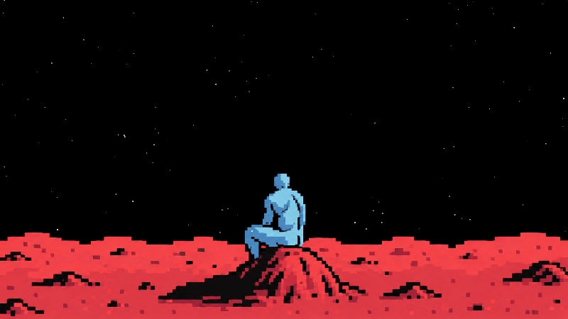
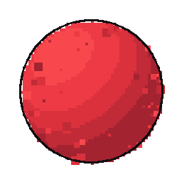
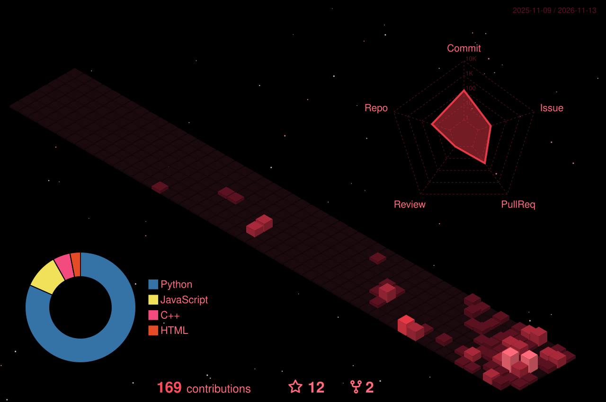

# Welcome to Saptadeep's GitHub `</>`

---

<h2 align="center">👩‍🚀 Crew Profile</h2>

<table>
<tr>
<td width="70%">

I open Github to distract me from the horrors of life

</td>
<td width="30%" align="center">

</td>
</tr>
</table>

---

<h2 align="center">🛰️ Payload</h2>

  
  
  
  
  
  
  
  
  
  

<h2 align="center">🚀 Mission Log</h2>

<table align="center">
<tr>
<td width="50%" valign="top">

<h3>🛰️ Denet</h3>

<code>MISSION 01</code>&nbsp;

A personal voice assistance

</td>
<td width="50%" valign="top">

<h3>🌕 NotesNest</h3>

<code>MISSION 02</code>&nbsp;

A webapp which is for students of my college course, which holds pyq papers, Notes, faculty details.

</td>
</tr>
</table>

<i>"Indifferent"</i>

